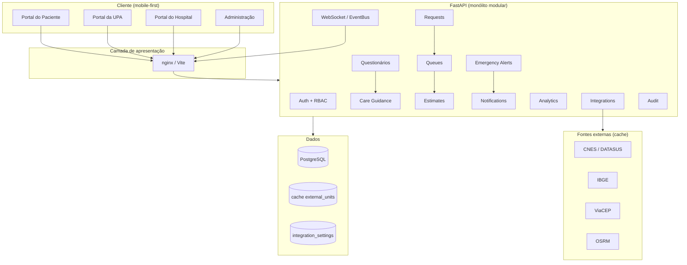
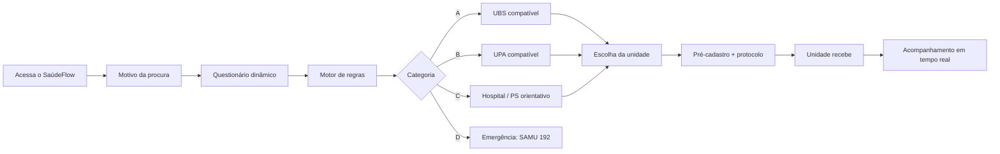
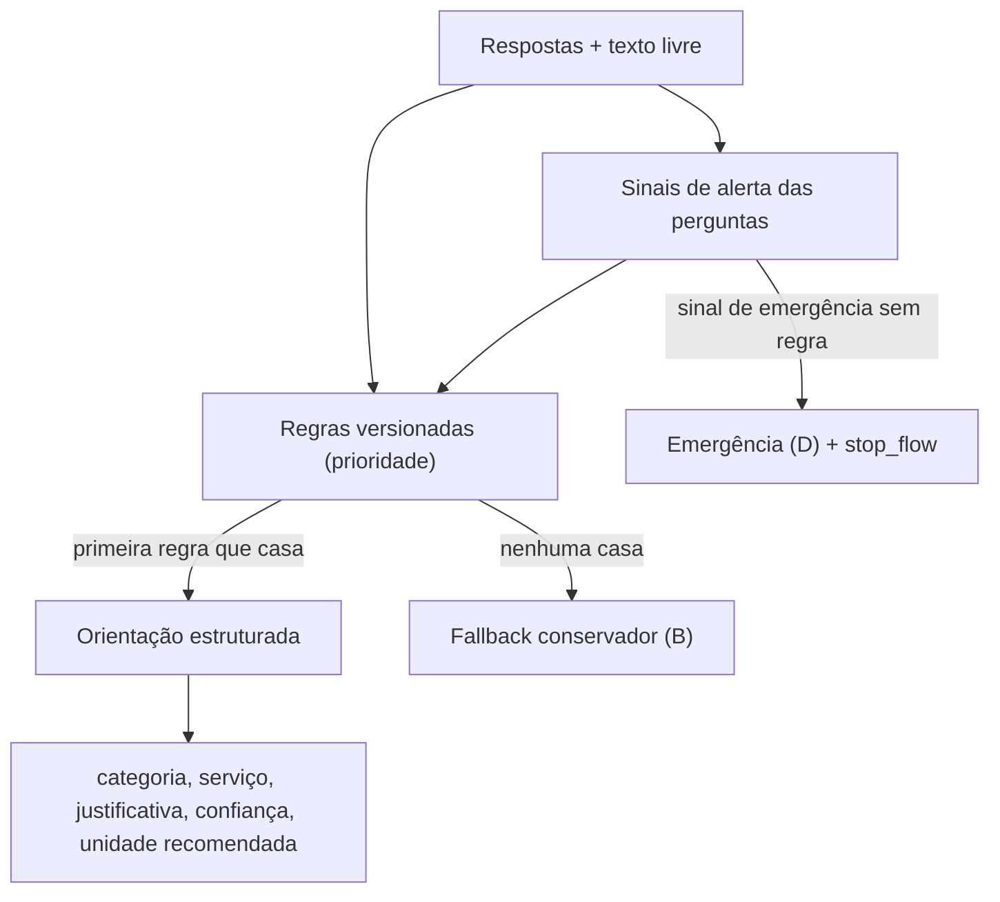
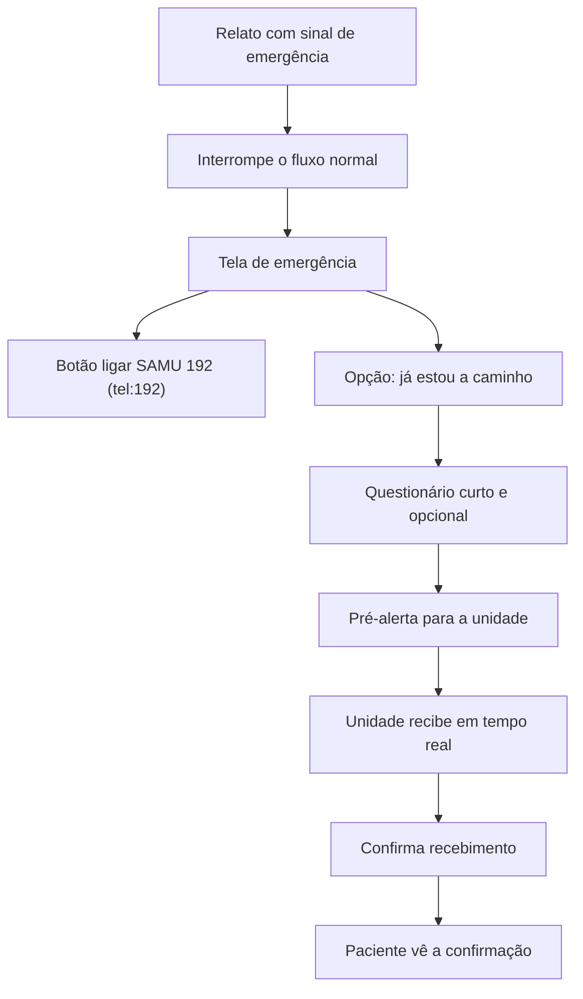
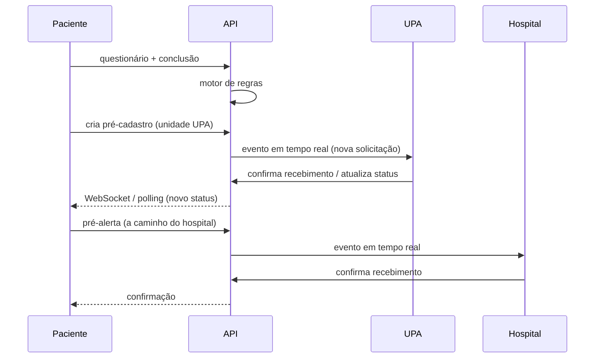

# Arquitetura

Monólito modular: um backend FastAPI com módulos bem delimitados e um frontend React. Sem microsserviços.

## 1. Arquitetura geral

## 2. Fluxo do paciente

## 3. Orientação de atendimento

O motor é **puro** (`app/services/guidance_engine.py`), não depende do React e é deterministicamente testável.

## 4. Fluxo de emergência

## 5. Integração entre portais

## 6. Módulos do backend

| Módulo | Responsabilidade |
| --- | --- |
| `auth` | registro, login, refresh, JWT, perfil |
| `users` | usuários, papéis e permissões (RBAC) |
| `units` | unidades, serviços, capacidade |
| `questionnaires` | versões, perguntas, opções, submissões, respostas |
| `care_guidance` | regras, resultados, motor de orientação |
| `requests` | solicitações, protocolos, eventos, status |
| `queues` | tickets, fila digital, check-in, atendimentos |
| `estimates` | cálculo e cache de estimativas |
| `emergency_alerts` | pré-alertas e confirmações |
| `notifications` | notificações internas |
| `analytics` | indicadores e relatórios |
| `integrations` | adaptadores, sincronização, cache, geolocalização |
| `audit` | trilha de auditoria |

Cada módulo segue a separação **router → service → repository → model → schema**, com testes.
