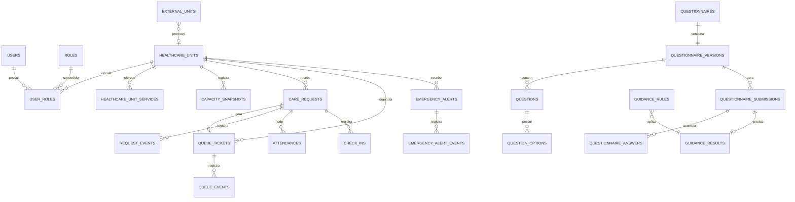

# Modelo de dados

## Diagrama entidade-relacionamento (resumido)

## Tabelas

### Identidade e acesso
- **users** — `id`, `email` (único), `hashed_password`, `full_name`, `phone`, `cpf`, `birth_date`, `is_active`, timestamps, soft delete.
- **roles** / **permissions** / **role_permissions** — RBAC.
- **user_roles** — `(user_id, role_id, unit_id)`; `unit_id` nullable para papéis globais (admin) e scoped (manager, recepção, etc.).

### Unidades
- **healthcare_units** — `type` (`ubs|upa|hospital|emergency`), `cnes_code` único, `source` (`manual|cnes|datasus`), `is_simulated`, endereço e lat/long.
- **healthcare_unit_services** — serviços e disponibilidade.
- **unit_staff** — vínculo de usuários à unidade com papel operacional.
- **capacity_snapshots** — histórico de profissionais, salas, acolhimento, situação excepcional.

### Questionário e orientação
- **questionnaires** / **questionnaire_versions** — versionamento e `rule_set_version`.
- **questions** — `external_id`, `type`, `conditional_logic` (JSON), `alert_flags` (JSON), `order_index`.
- **question_options** — opções com `alert_flag`.
- **questionnaire_submissions** / **questionnaire_answers** — respostas (`value_json` ou `value_text`).
- **guidance_rules** — condições JSON, prioridade, categoria, `stop_flow`, `confidence`, mensagem.
- **guidance_results** — resultado persistido por submissão.

### Solicitações, filas e estimativas
- **care_requests** — `protocol` único (`SF-AAAA-NNNNNN`), status, categoria, paciente.
- **request_events** — histórico de status.
- **queue_tickets** / **queue_events** — fila digital administrativa (não clínica).
- **check_ins** / **attendances** — presença e duração (alimenta estimativas).
- **capacity_snapshots** — capacidade atual e histórico.
- **wait_estimates** — cache da estimativa por unidade.

### Emergência, notificações e auditoria
- **emergency_alerts** / **emergency_alert_events** — pré-alertas e confirmações.
- **notifications** — notificações internas por usuário.
- **audit_logs** — ações relevantes, com ator, entidade e IP.

### Integrações
- **integration_sources** — fontes e limites.
- **external_units** — cache de CNES/DATASUS com `source`, `external_id`, payload original e `fetched_at`.
- **sync_logs** — execução, contagens e erros.
- **integration_settings** — chaves de cache (ViaCEP, IBGE, OSRM).

## Integridade e segurança

- Chaves primárias UUID; FKs com `ON DELETE` adequado; índices em campos de filtro e ordenação.
- `protocol` único, contador transacional por ano.
- Unique `(source, external_id)` no cache externo.
- Timestamps `created_at`/`updated_at`; soft delete em usuários e unidades.
- Migrations via Alembic (`backend/alembic/versions`).
